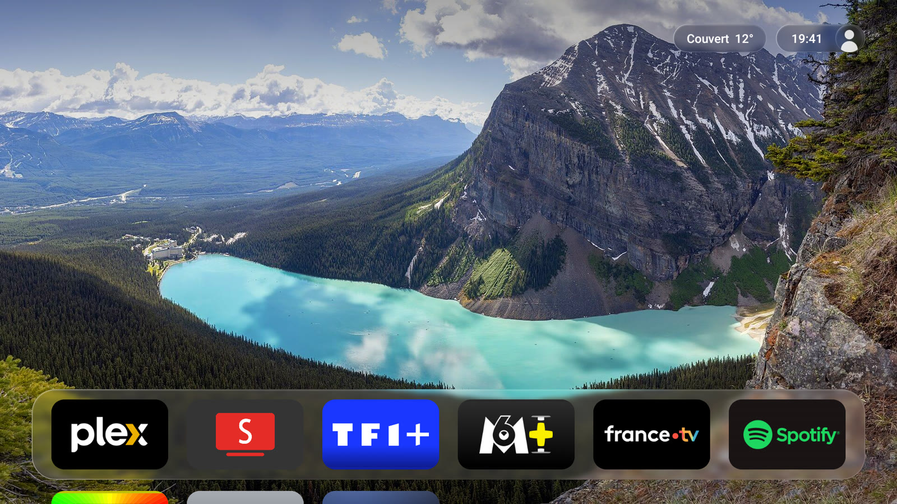
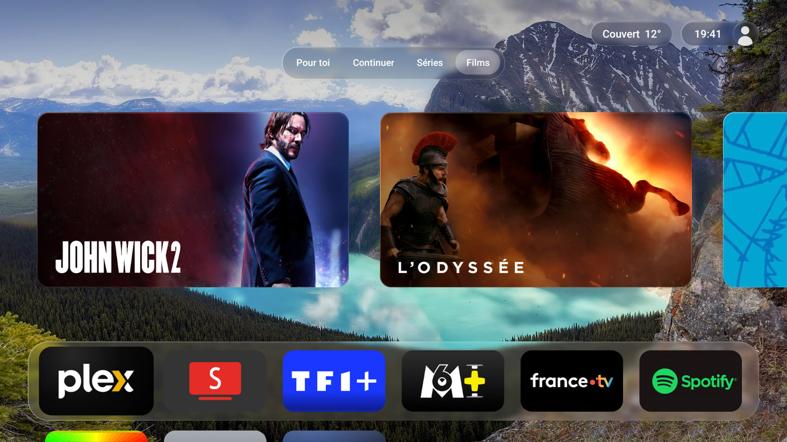
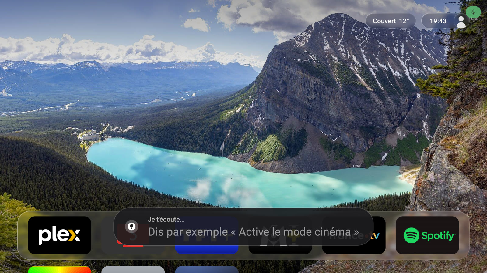
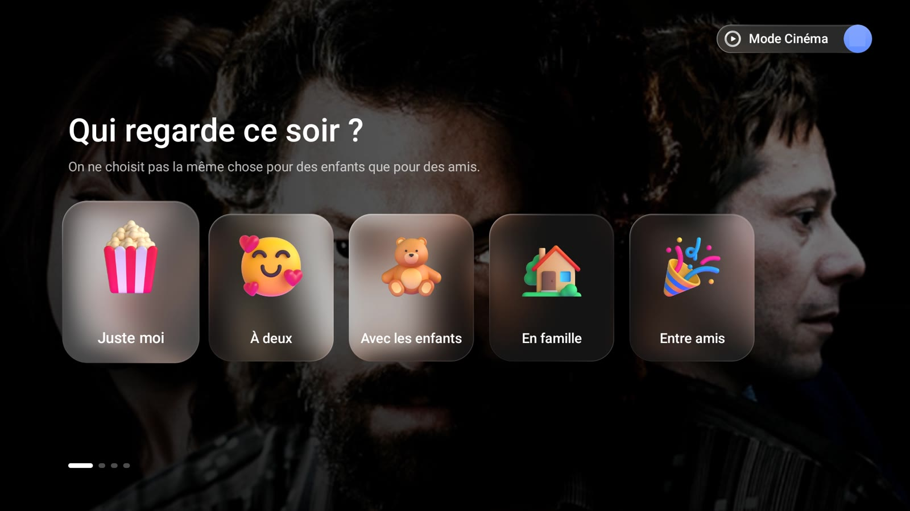
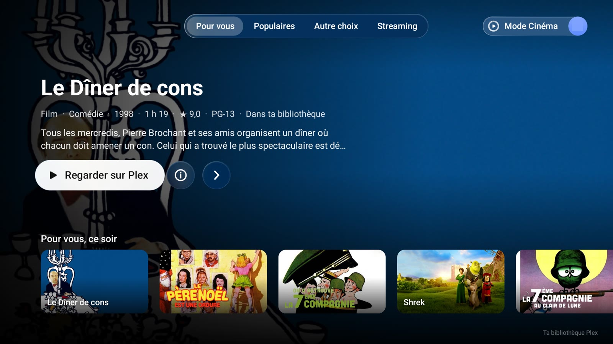

<p align="center">
  
</p>

<p align="center">
  <b>Un écran d'accueil façon Apple TV pour les téléviseurs TCL sous Google TV, en français.</b><br>
  <a href="README.en.md">English (original)</a> · <a href="README.ro.md">Română</a>
</p>

<p align="center">
  
</p>

> [!NOTE]
> Ce dépôt est un fork de [**tinulica/tv-home**](https://github.com/tinulica/tv-home). Tout le mérite du
> launcher d'origine (Liquid Glass, Centre de contrôle, mode Cinéma, notices météo, outil de
> nettoyage) revient à son auteur. Ce fork le traduit en français et ajoute ce qui suit.

---

## ✨ Ce que ce fork ajoute

| | |
|---|---|
| 🇫🇷 **Traduction en français** | Toute l'interface. |
| 🎬 **Gestion Plex** | Les tuiles de l'app sur la home affichent les films et séries « Reprendre / Films / Séries » dans le style Apple TV, ainsi que les affiches. |
| 🍿 **Mode Cinéma amélioré** | Ajout de Plex pour le mode Cinéma, qui prend donc ses sources dans votre bibliothèque. On peut toujours basculer sur le mode original dans les réglages. En entrant dans le mode Cinéma, les lumières choisies dans Home Assistant s'éteignent, puis se rallument en sortant (seulement celles qui étaient allumées). Voir [Configuration](#configuration). |
| 🌦️ **Fonds d'écran animés selon l'heure et la météo** | Le launcher choisit celui qui correspond au moment de la journée (heures réelles du lever et du coucher du soleil) et au ciel. *Vidéos non fournies*, voir [Configuration](#fonds-animes). |
| 🌙 **Écran de veille** | Le fond animé en plein écran, l'heure en grand et la météo en dessous. |
| 🎙️ **Micro de la télécommande** | Une bulle d'écoute par-dessus n'importe quelle appli : « Active le mode cinéma », « Ouvre Plex », « Quel temps fait-il ? », « Réglages »… et tout le reste devient une recherche. |
| 🎮 **Pas de mise en veille en jeu** | Tant qu'une source HDMI (console, box) ou l'antenne est à l'écran, la télé ne lance plus l'écran de veille et ne s'éteint plus pour inactivité. |
| ⚙️ **Réglages TCL par-dessus les applis** | La touche engrenage ouvre le panneau rapide comme un overlay, au lieu de quitter l'appli ou la source en cours. |

### 📸 En images

<table>
  <tr>
    <td width="50%"></td>
    <td width="50%"></td>
  </tr>
  <tr>
    <td align="center"><b>🎬 Plex sur l'accueil</b><br><sub>Films et séries de ta bibliothèque, façon Apple TV</sub></td>
    <td align="center"><b>🎙️ Le micro</b><br><sub>Une bulle d'écoute par-dessus n'importe quelle appli</sub></td>
  </tr>
  <tr>
    <td width="50%"></td>
    <td width="50%"></td>
  </tr>
  <tr>
    <td align="center"><b>🍿 Mode Cinéma</b><br><sub>Quelques questions : pour qui, quoi, quelle humeur…</sub></td>
    <td align="center"><b>🍿 … et ce qu'il te propose</b><br><sub>Tiré de ta bibliothèque Plex, lancé en un clic</sub></td>
  </tr>
</table>

---

<a name="configuration"></a>

## 🛠️ Configuration

> [!IMPORTANT]
> **Depuis l'ordinateur, une seule fois.** Tout se règle depuis un ordinateur relié à la télé par
> `adb` (voir l'installation dans le [README d'origine](README.en.md) : `python tvtool.py connect <IP de la télé>`
> s'en occupe). Les adresses et les jetons restent dans le stockage privé du launcher, sur la télé,
> et ne partent que vers ton propre serveur.

### 💡 Lumières avec Home Assistant

1. **Créer un jeton dans HA** : **Profil** (nom en bas à gauche) → **Sécurité** → **Jetons d'accès longue durée** (section en bas) → **Créer un jeton**.
   > ⚠️ Il ne s'affiche qu'une fois : copiez-le tout de suite.
2. **Trouver les lumières** que vous voulez connecter au mode Cinéma : **Aperçu** (tableau de bord) → cliquer sur un appareil → **⚙️ Engrenage** → case **« ID de l'entité »**, par exemple `switch.prise`.
3. **Envoyer les infos sur la TV** avec la commande ci-dessous, depuis un terminal (cmd) avec `adb` :

```sh
adb shell am start -n ro.tinulica.tvhome/.MainActivity \
    --es ha_url http://ip-de-ha --es ha_token <jeton> \
    --es ha_entities light.salon,switch.prise
```

### 🎬 Plex et le mode Cinéma

1. **Obtenir le jeton** : cliquer sur n'importe quel film → **Obtenir des infos** → **Afficher le XML**. Dans l'URL de la page qui s'ouvre, tout à la fin : `X-Plex-Token=` suivi d'une vingtaine de caractères.
2. **L'envoyer sur la TV** avec l'adresse du serveur :

```sh
adb shell am start -n ro.tinulica.tvhome/.MainActivity \
    --es plex_url 192.168.1.10:32400 --es plex_token <jeton>
```

### 🎙️ Micro

Le micro a besoin de l'autorisation d'enregistrer et, sur les TCL où l'assistant Google a été retiré, du rôle d'assistant :

```sh
adb shell pm grant ro.tinulica.tvhome android.permission.RECORD_AUDIO
adb shell cmd role add-role-holder android.app.role.ASSISTANT ro.tinulica.tvhome
```

> [!WARNING]
> Sur les firmwares TCL récents, le système peut empêcher le service du launcher de redémarrer tout
> seul (notices, volume, engrenage qui ne marchent plus après une mise à jour). Dans ce cas :
>
> ```sh
> adb shell appops set ro.tinulica.tvhome APP_AUTO_START allow
> ```

<a name="fonds-animes"></a>

### 🌦️ Fonds d'écran animés

**1. Préparer vos fonds d'écran** en les nommant de cette manière : `<moment>[_<météo>].mp4`

| `<moment>` | `<météo>` |
|---|---|
| `morning` (matin) | `sun` |
| `day` (journée) | `cloud` |
| `evening` (soir) | `fog` |
| `night` (nuit) | `wind` |
| `late night` (fin de nuit) | `rain` · `thunder` · `snow` |

Exemples : `day_rain.mp4`, `evening_snow.mp4`. Cela peut aussi être juste un moment, sans être lié obligatoirement à une météo : `late night.mp4`, `day.mp4`.

> [!TIP]
> Il ne faut pas nécessairement avoir une vidéo pour chaque cas : **3 vidéos suffisent pour commencer**. Le système prendra la vidéo qui s'en rapproche le plus.

**Conseils :**
- 🎞️ Vidéo en **H.265**
- 📐 **Max 4K, 60 img/s**
- 🔇 **Sans son**
- 🔁 **Loop propre** à la fin
- 🔎 À chercher sur YouTube / Wallpaper Engine

**2. Les envoyer sur la TV :**

```sh
adb push day_rain.mp4 /sdcard/Android/data/ro.tinulica.tvhome/files/dynamic/
```

**3. Pour les utiliser en écran de veille :**

```sh
adb shell settings put secure screensaver_components ro.tinulica.tvhome/.WallpaperDream
adb shell settings put secure screensaver_enabled 1
```

**4. Facultatif** (affichage du fond dans les réglages) :

```sh
ffmpeg -ss 1 -i day_rain.mp4 -frames:v 1 -vf scale=1280:-2 day_rain.jpg
adb push day_rain.jpg /sdcard/Android/data/ro.tinulica.tvhome/files/dynamic/stills/
```

---

📖 Pour l'installation de base, le nettoyage et tout le reste, voir le [**README d'origine**](README.en.md).
